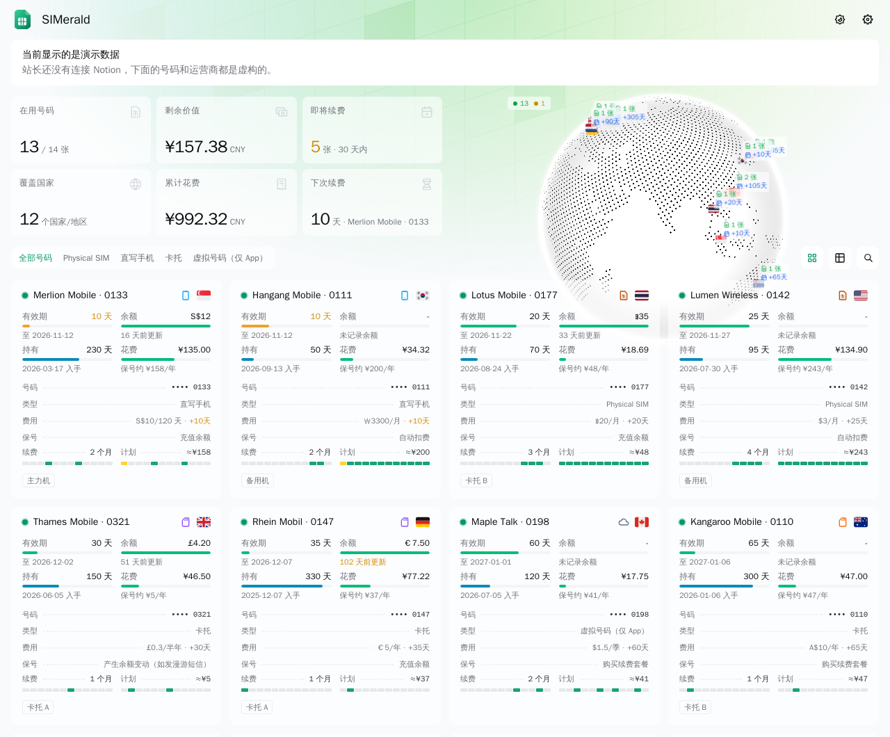

# SIMerald

把你在 Notion 里登记的 SIM / eSIM 号码，用 [Komari Emerald](https://github.com/Tokinx/komari-theme-emerald) 主题的样子展示出来。

VPS 和 SIM 卡有很多相似之处：都要续费、都有价格和到期日、都来自世界各地。SIMerald 保留了 Emerald 的地球、统计卡片、卡片墙、详情页和深色模式，把 CPU、内存、流量这些 VPS 专属的内容换成了 SIM 卡的有效期、余额、保号方式和续费记录。



## 功能

- **旋转地球 / 点状地图**：按号码所属国家标点，显示每个国家在用几张、最近一次续费还有几天
- **顶部统计**：在用号码、覆盖国家、即将续费、下次续费、累计花费，以及沿用 Emerald 的「剩余价值 / 总价值 / 月均支出」和今日汇率
- **卡片墙**：四种卡片样式（名片、徽章、表盘、横条），访客自己切换；有效期圆环按本期还剩几成变色，加上购入价、每年保号成本和运营商 Logo，按大洲分组
- **详情页**：号码、保号、余额、账号信息，以及续费历史图表和逐笔明细
- **公开但打码**：访客只能看到号码后 4 位；完整号码、管理账号、绑定的服务、扣款账户只有站长登录后才返回（在后端过滤，浏览器里查不到）
- **站长登录**：密码 + TOTP 两步验证 + 一次性恢复码，连续输错会被暂时锁定
- **网页设置面板**：公告、头部展示模式、背景等主题设置，Notion 连接，同步时间，账号安全
- **每天自动同步**：默认每天 05:00（北京时间）从 Notion 拉取一次，也可以在后台点「立即同步」
- **演示模式**：没有配置 Notion 时显示内置的虚构数据

SIMerald 只读取 Notion，不会修改里面的任何内容。

## 部署

需要 Docker。

```bash
git clone <你的仓库地址> simerald
cd simerald/deploy
mkdir -p data && sudo chown 1000:1000 data
docker compose up -d --build
```

服务只监听本机的 `127.0.0.1:25780`，请用 Nginx、Caddy 或 Cloudflare 隧道等反向代理对外提供 HTTPS 访问。

### 首次设置

1. 运行 `docker logs simerald`，找到「首次设置密钥」（也保存在数据目录的 `setup-key.txt` 里）
2. 打开 `https://你的域名/admin`，输入设置密钥并设置站长密码
3. 用手机验证器 App 扫码绑定两步验证，保存好恢复码

### 连接 Notion

1. 打开 [Notion integrations](https://www.notion.so/profile/integrations)，新建一个 Internal integration，只给「读取内容」权限，复制 token
2. 在 Notion 里打开放数据库的页面，点右上角 `···` →「连接」，选中刚建的 integration
3. 在 SIMerald 后台的「Notion 连接」里填入 token 和数据库链接，保存后会立即同步

token 也可以用环境变量 `NOTION_TOKEN` 提供，数据库 ID 可以用 `NOTION_CARDS_DB`、`NOTION_RECORDS_DB`、`NOTION_ACCOUNTS_DB` 提供。

## Notion 数据库

SIMerald 需要两个数据库，第三个可选：

| 数据库           | 作用                                                  |
| ---------------- | ----------------------------------------------------- |
| SIM 卡           | 每张卡一行                                            |
| 消费记录         | 首次购买、续费、充值的每一笔，通过关联字段指向 SIM 卡 |
| 扣款账户（可选） | 只用来显示扣款账户的名称                              |

默认的列名见 [`server/mapping.ts`](server/mapping.ts)。你的列名不一样时，在后台「Notion 连接 → 字段映射」里修改即可。主要的列：

- **SIM 卡**：卡片名称（标题，建议写成「运营商 · 号码后 4 位」）、号码、号码国家（单选，选项以国旗 emoji 开头，例如「🇭🇰 中国香港」）、卡片类型、续费周期（例如「每 30 天」）、续费金额、续费币种（例如「HKD HK$」）、当前余额、余额更新日期、当前有效期至、下次续费日期、号码状态、停用日期等
- **消费记录**：记录（标题）、SIM 卡（关联）、消费类型、消费日期、支付金额、货币、当时汇率、等额 CNY、本次有效期延至、扣款账户（关联）

「当前有效期至」「下次续费日期」「号码状态」这类字段可以是 Notion 公式，SIMerald 直接读取公式算出的结果。

## 数据和安全

- 数据目录里有站长密码的哈希、两步验证密钥、Notion token、设置和同步缓存，请定期备份，不要提交到 Git
- 公开接口用白名单挑选可公开的字段，敏感字段只在登录后返回
- 修改类请求要求带 `X-SIMerald-Request` 请求头，会话 cookie 为 `HttpOnly` + `SameSite=Strict`

## 本地开发

```bash
npm install
npm run dev:server   # 后端，默认 http://127.0.0.1:25780，没有 Notion token 时显示演示数据
npm run dev          # 前端开发服务器，会把 /api 转发给后端
```

提交前运行 `npx eslint .`、`npm run type-check` 和 `npm run build-only`。

## 作者

- [BurningSky0306](https://github.com/BurningSky0306)
- [Claude](https://claude.com/claude-code)（Anthropic）：和作者一起完成需求梳理、设计和开发

## 致谢

- 界面基于 [Komari Emerald](https://github.com/Tokinx/komari-theme-emerald)（MIT，作者 Tokinx）修改
- 国旗图标来自 [Twemoji](https://github.com/jdecked/twemoji)（CC-BY 4.0）
- 灵感来自 [Komari Monitor](https://github.com/komari-monitor/komari)

## 许可证

[MIT](LICENSE)
