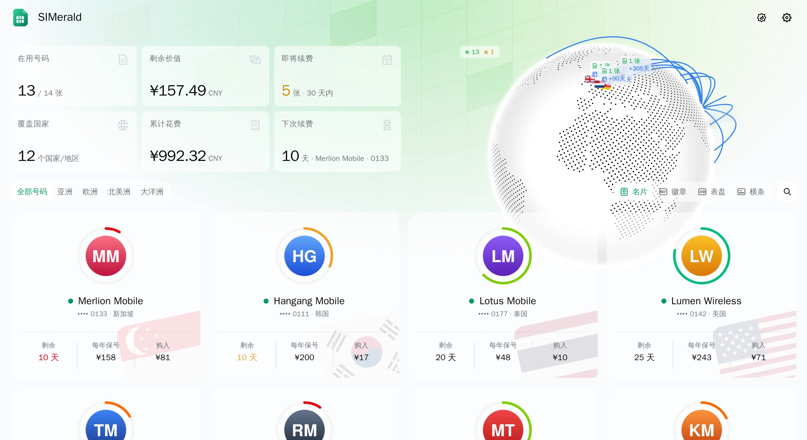

<div align="center">

# SIMerald

**把 Notion 里的 SIM / eSIM 收藏，做成一面可以公开展示的卡片墙。**

<picture>
  <source media="(prefers-color-scheme: dark)" srcset="docs/screenshot-dark.webp">
  
</picture>

</div>

SIMerald 改自 [Komari Emerald](https://github.com/Tokinx/komari-theme-emerald) 主题。地球、统计卡、卡片墙和深色模式都还在，只是把 VPS 的 CPU、内存和流量，换成了 SIM 卡的有效期、保号成本和续费记录。

## 特性

- **三种卡片样式**：名片、表盘、横条，访客在右上角自选
- **有效期圆环**：按本期还剩几成着色，每张卡只和自己的续费周期比
- **地球与统计**：按国家落点；在用号码、覆盖国家、即将续费、累计花费一屏看完
- **公开但打码**：访客只看到号码后 4 位；完整号码、使用设备、账号等字段在后端就被滤掉
- **只读 Notion**：每天自动同步一次，也能手动同步，从不改动 Notion 里的内容
- **网页后台**：密码加两步验证登录；主题、公告、同步时间、字段映射都在后台设置

## 部署

```bash
git clone https://github.com/BurningSky0306/simerald.git
cd simerald/deploy
mkdir -p data && sudo chown 1000:1000 data
docker compose up -d --build
```

服务只监听 `127.0.0.1:25780`，用 Caddy、Nginx 或 Cloudflare Tunnel 对外提供 HTTPS。

1. 在 `docker logs simerald` 里找到首次设置密钥（也存在 `data/setup-key.txt`）
2. 打开 `/admin`，设置密码、绑定两步验证、保存恢复码
3. 在后台「Notion 连接」填入 token 和数据库链接，保存后立即同步

> 数据目录里有密码哈希、两步验证密钥和 Notion token。记得备份，别提交到 Git。

## 接入 Notion

需要两个数据库：**SIM 卡**（一张卡一行）和**消费记录**（开卡、续费、充值各记一笔，用关联字段指向 SIM 卡）。**扣款账户**数据库可选。

1. 在 [Notion integrations](https://www.notion.so/profile/integrations) 新建 Internal integration，只给「读取内容」权限
2. 在数据库所在页面点 `···` →「连接」，选中它
3. 把 token 和数据库链接填进后台

默认列名见 [`server/mapping.ts`](server/mapping.ts)，对不上就在后台「字段映射」里改。有效期、号码状态这类列可以是公式。也可以不在后台填，改用环境变量 `NOTION_TOKEN`、`NOTION_CARDS_DB`、`NOTION_RECORDS_DB`、`NOTION_ACCOUNTS_DB`。

## 运营商 Logo

把图片放进数据目录的 `logos/`，文件名写运营商名称，比如 `Harbour Mobile.png`（大小写、空格和标点不敏感，支持 png / webp / jpg / svg）。没有图片的卡显示首字母。Logo 不进仓库。

## 开发

```bash
npm install
npm run dev:server   # 后端；没有 Notion token 时使用演示数据
npm run dev          # 前端；/api 转发到后端
```

提交前跑一遍 `npx eslint .`、`npm run type-check` 和 `npm run build-only`。

## 致谢

界面改自 [Komari Emerald](https://github.com/Tokinx/komari-theme-emerald)（MIT，Tokinx），灵感来自 [Komari Monitor](https://github.com/komari-monitor/komari)，国旗来自 [Twemoji](https://github.com/jdecked/twemoji)（CC-BY 4.0）。

由 [BurningSky0306](https://github.com/BurningSky0306) 和 [Claude](https://claude.com/claude-code) 一起完成，以 [MIT](LICENSE) 协议发布。
