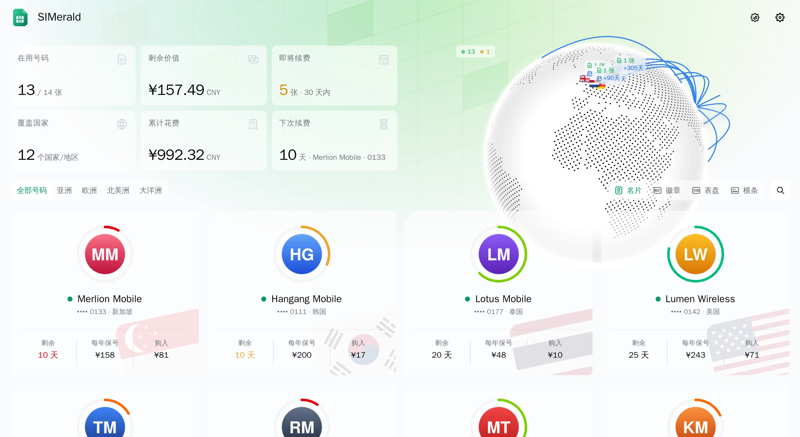

<div align="center">

# SIMerald

**把 Notion 里的 SIM / eSIM 收藏，做成一面可以公开展示的卡片墙。**

<picture>
  <source media="(prefers-color-scheme: dark)" srcset="docs/screenshot-dark.webp">
  
</picture>

[](LICENSE) [](https://linux.do)

[English](README.md) | 简体中文

</div>

SIMerald 是一个自托管的 SIM / eSIM 收藏展示网站，数据从 Notion 数据库同步。项目派生自 [Komari Emerald](https://github.com/Tokinx/komari-theme-emerald) 主题，保留了地球、统计卡、卡片墙和深色模式，将原本面向 VPS 监控的 CPU、内存和流量指标改造为 SIM 卡的有效期、保号成本与续费记录。网页界面仅提供简体中文（无多语言支持）。

## 特性

- **三种卡片样式**：支持名片（`namecard`）、表盘（`dial`）、横条（`bar`）三种视图。访客可在首页右上角切换，默认样式可在后台配置。
- **有效期圆环**：按当前周期剩余比例计算长度与颜色，每张卡仅与自身的续费周期对比。
- **地球与统计卡片**：按号码国家在 3D 地球或点状地图上落点；统计栏展示在用号码、覆盖国家、30 天内即将续费、下次续费、累计花费与剩余价值。
- **后端隐私脱敏**：访客仅能看到号码后 4 位。完整号码、具体卡片类型、主要使用设备、余额、绑定的服务、管理账号、扣款账户、数据检查、Notion 页面链接及消费记录标题均在后端过滤，不会出现在公开接口响应中。
- **只读同步 Notion**：按设定的时间每日自动同步一次，也支持在后台手动触发同步；仅读取 Notion 数据，绝不写入或修改。
- **内置管理后台**：只有一个站长账号，采用密码（scrypt）加 TOTP 两步验证登录；支持在网页端修改主题设置、公告、同步时间及 Notion 字段映射。

## 部署

克隆仓库并使用 Docker Compose 启动服务：

```bash
git clone https://github.com/BurningSky0306/SIMerald.git
cd SIMerald/deploy
mkdir -p data && sudo chown 1000:1000 data
docker compose up -d --build
```

默认配置下，`deploy/compose.yaml` 仅监听本机 `127.0.0.1:25780`，容器内以 UID `1000` 运行，并将宿主机的 `./data` 挂载到 `/data`。请通过 Caddy、Nginx 等反向代理或 Cloudflare Tunnel 对外提供 HTTPS 服务。

请根据实际代理方式设置 `deploy/compose.yaml` 中的 `TRUST_PROXY`（可选 `cloudflare`、`xff` 或 `none`），以确保登录失败按 IP 锁定时能获取真实客户端地址。环境变量与代理配置详情参见 [`docs/configuration.md`](docs/configuration.md)。

> 数据目录中包含密码哈希、两步验证密钥、Notion token、站点设置和同步缓存。请定期备份该目录，切勿将其提交到 Git 仓库。

## 首次设置

1. 从容器日志（`docker logs simerald`）或 `data/setup-key.txt` 文件中获取一次性设置密钥。
2. 在浏览器中打开 `https://sim.example.com/admin`。
3. 输入设置密钥，设置站长密码，绑定 TOTP 验证器应用，并妥善保存生成的一次性恢复码。
4. 在配置 Notion token 之前，SIMerald 会运行于演示模式并展示内置示例数据。

## 接入 Notion

官方 Notion 模板包含一个带续费一览与消费图表的控制台页面，以及「📱 SIM 卡」「💰 消费记录」「💳 支付账户」三个源数据库（即使不部署 SIMerald 也可单独作为续费看板使用）：

- **中文模板**：[SIMerald · SIM / eSIM 总控台（模板 v1）](https://blossom-elk-1de.notion.site/SIMerald-SIM-eSIM-v1-9aa81cd90a0f83eb92dd01597a2b9cde)
- **English template**：[SIMerald · SIM / eSIM Console (Template v1)](https://blossom-elk-1de.notion.site/SIMerald-SIM-eSIM-Console-Template-v1-79581cd90a0f83d29c5a81659658c201)

接入只需 5 步：

1. **复制模板**：打开上方任一模板链接，点击右上角「复制」（Duplicate）到你的 Notion 工作区。
2. **创建只读集成**：前往 [Notion Integrations](https://www.notion.so/profile/integrations) 新建内部集成，「能力」仅勾选「读取内容」（Read content），用户信息选「不包含用户信息」，保存并复制 `ntn_` 开头的密钥（Token）。
3. **授权页面**：打开复制后的模板页面，点击右上角「•••」→「连接」（Connections），选择刚创建的集成。
4. **后台自动识别**：登录 `https://<你的域名>/admin`，在「Notion 连接」面板填入 Token，点击「自动识别」自动匹配模板与数据库 ID，然后点击「保存」。
5. **验证并替换数据**：首页出现 3 张 🧪 示例卡后，在 Notion 中删掉带 🧪 的示例行、添加你自己的卡片，再回后台点击「立即同步」。

详细教程与常见问题见 [docs/notion-setup.zh-CN.md](docs/notion-setup.zh-CN.md)，模板完整字段与公式定义见 [docs/notion-template/template.zh-CN.md](docs/notion-template/template.zh-CN.md)。

## 运营商 Logo

将运营商图标放入数据目录的 `logos/` 子目录下（例如 `data/logos/Harbour Mobile.png`）。

- 支持格式：`.png`、`.webp`、`.jpg`、`.jpeg`、`.svg`。
- 文件名按运营商名称匹配，比较时忽略大小写、空格、标点和符号（例如 `Harbour Mobile.png` 和 `harbour-mobile.webp` 均可匹配 `Harbour Mobile`）。
- 未匹配到图片时，卡片将显示运营商名称的首字母。
- 目录文件列表缓存 1 分钟，替换图片后会自动更新版本号参数。

## 开发

运行环境要求 Node.js `>= 22.18.0`。后端利用 Node 原生类型剥离（type stripping）直接执行 TypeScript 源码，无运行时第三方依赖，也无需单独编译。

```bash
npm install
npm run dev:server   # 启动后端（监听 :25780，未配置 Notion token 时使用演示数据）
npm run dev          # 启动 Vite 前端开发服务器，将 /api 代理至后端
```

提交代码前请执行代码检查、类型检查和构建验证：

```bash
npx eslint .
npm run type-check
npm run build-only
```

代码结构与开发规范参见 [`AGENTS.md`](AGENTS.md)、[`src/AGENTS.md`](src/AGENTS.md) 和 [`docs/design.md`](docs/design.md)。

## 致谢

- 界面派生自 [Komari Emerald](https://github.com/Tokinx/komari-theme-emerald)（MIT，Tokinx），设计灵感来自 [Komari Monitor](https://github.com/komari-monitor/komari)
- 国旗图标来自 [Twemoji](https://github.com/jdecked/twemoji)（CC-BY 4.0）
- 感谢 [LINUX DO](https://linux.do) 社区

## 作者与协议

由 [BurningSky0306](https://github.com/BurningSky0306)、**Claude Opus 5.5** 和 **Gemini 4 Argon** 共同构建，基于 [MIT](LICENSE) 协议发布。
