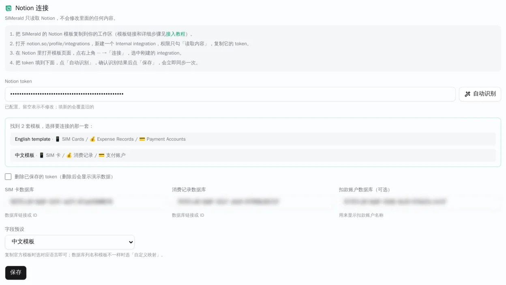
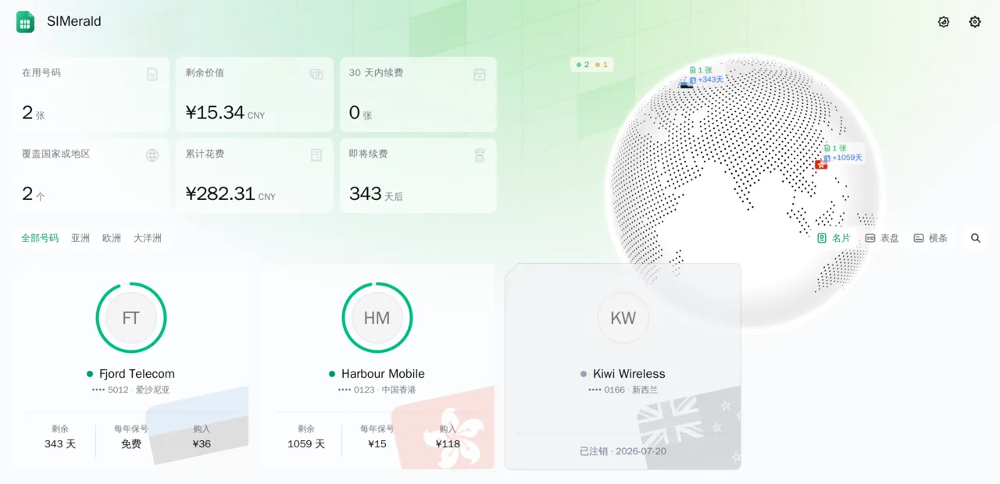

# Connecting Notion

English | [简体中文](notion-setup.zh-CN.md)

SIMerald uses Notion as its data source. The official Notion template includes a console page (with a usage guide at the top, a "📊 Renewals" table sorted by next renewal date, and "💰 Spending" charts) plus a sub-page named "Source databases (do not delete)" containing three databases:

- **📱 SIM Cards**: one row per card
- **💰 Expense Records**: one row per purchase, renewal, top-up or other fee, linked to a card
- **💳 Payment Accounts** (optional): only used to show account names to the signed-in owner

Rows with the 🧪 icon are fictional samples (3 cards: `Harbour Mobile · 0123`, `Fjord Telecom · 5012`, and cancelled `Kiwi Wireless · 0166`; 5 expense records; 2 payment accounts). The template also works on its own as a renewal tracker even without SIMerald. For the full column list and formula source, see [docs/notion-template/template.md](notion-template/template.md).

> **Note:** The SIMerald web UI (including the admin panel) is currently in Simplified Chinese only. English UI is planned for a later release. In the steps below, Chinese button and panel labels are given in parentheses.

## What You Need

- A Notion account
- A running SIMerald instance (see the [README](../README.md) for first-time setup)

## 1. Duplicate a Template

- Open one of the official public templates:
  - English template: [SIMerald · SIM / eSIM Console (Template v1)](https://blossom-elk-1de.notion.site/SIMerald-SIM-eSIM-Console-Template-v1-79581cd90a0f83d29c5a81659658c201)
  - Chinese template: [SIMerald · SIM / eSIM 总控台（模板 v1）](https://blossom-elk-1de.notion.site/SIMerald-SIM-eSIM-v1-9aa81cd90a0f83eb92dd01597a2b9cde)
- Click **"Duplicate"** (「复制」) at the top right of the page and pick your Notion workspace.

## 2. Create an Integration

- Open [https://www.notion.so/profile/integrations](https://www.notion.so/profile/integrations) and click **"New integration"** (「新建集成」).
- Name it (e.g. `SIMerald`), choose the workspace you duplicated the template into, select type **"Internal"** (「内部」), and save.
- In its configuration under **"Capabilities"** (「能力」), keep **ONLY "Read content"** (「读取内容」) ticked (untick update content and insert content); under user information, select **no user information**, then save.
- Copy the **"Internal Integration Secret"** (「内部集成密钥」, starts with `ntn_`). This is your Notion token—keep it private.

## 3. Give the Integration Access

- Open your duplicated template page (the console page) in Notion.
- Click **"•••"** at the top right → **"Connections"** (「连接」), search for your integration name, select it, and confirm.
- Access automatically applies to the page and all of its sub-pages, covering all three source databases.

## 4. Connect in SIMerald

- Open `https://<your-domain>/admin` and sign in.
- In the **Notion connection (「Notion 连接」)** panel, paste your token and click **Auto-detect (「自动识别」)**.
- SIMerald lists the databases the integration can read, finds the template (detecting whether it is the Chinese or English template and selecting the matching **Field preset (「字段预设」)**), and fills in the three database IDs. If several templates are found, a list appears so you can pick one.
- Click **Save (「保存」)**: SIMerald saves the settings and immediately runs a sync.



## 5. Check & Replace Sample Data

- Check the **Data sync (「数据同步」)** panel: it should show `同步正常` (sync OK), `3 张` cards, and `5 条` records; the home page will display the three 🧪 sample cards.
- In Notion, delete the 🧪 sample rows in the cards, records, and accounts databases, then add your own cards.
- In SIMerald, click **Sync now (「立即同步」)** (or wait for the daily automatic sync, which runs at `05:00` Asia/Shanghai by default and is configurable).



## FAQ

### Auto-detect (「自动识别」) finds nothing / shows `没找到 SIMerald 模板`?

- Right after connecting the integration, Notion's search index can take a minute or two to include newly shared pages—wait briefly and retry.
- Make sure you connected the **duplicated** template page in your own workspace, not the public template link.
- Make sure the integration belongs to the same workspace as the duplicated page.

### What do the sync error messages mean?

- `Notion token 无效或已被撤销`: The token is wrong or the integration was deleted.
- `Notion integration 没有读取权限`: Enable **"Read content"** (「读取内容」) in the integration's capabilities.
- `找不到数据库：ID 不对，或者没有把页面共享给这个 integration`: Wrong database ID, or the page was not shared with the integration via **"••• → Connections"**.
- `Notion 请求太频繁`: Rate-limited by Notion; wait and retry.

A failed sync always keeps the last known good data on your site.

### Columns are not matching?

After each sync, the **Data sync (「数据同步」)** panel lists any mapped columns that are missing or have an unexpected type (`●` marks fields that affect the public card wall; `○` marks owner-only fields). Fix this by:

- Restoring the original column name in Notion;
- Picking the matching **Field preset (「字段预设」)** (`中文模板` / `English template`); or
- Using **Custom mapping (「自定义映射（JSON）」)**.

### How do I rename columns or use my own databases?

Choose **Custom mapping (「自定义映射（JSON）」)** as the **Field preset (「字段预设」)** and enter JSON overriding the Chinese template's column names, for example:

```json
{ "cards": { "name": "Name", "number": "Phone" }, "records": { "card": "Card" } }
```

You can also override option value lists with `statusValues` (active / expired / cancelled texts) and `recordTypes` (purchase / renewal / topup texts). See [docs/configuration.md](configuration.md) for the full key list. Note that the template's formulas reference columns by name, so if you rename columns in Notion you must update the formulas too.

### What is the "⚠️ Data Check" (「⚠️ 数据检查」) column?

It is a template formula that points out missing or inconsistent data (wrong phone number format, missing exchange rate for foreign currency, a renewal without "Extends To", etc.). An empty cell means everything looks fine. Warnings are only shown in Notion and to the signed-in owner in SIMerald; they do not block syncing.

### Why are charts not shown in Notion?

Notion's free plan limits how many charts a workspace can display. Charts that cannot be displayed can simply be deleted—SIMerald does not use them.

### Why do the sample cards eventually show as expired?

Their expiration dates are fixed (e.g. `Fjord Telecom` is valid until `2027-10-15`). Delete the 🧪 sample rows once you no longer need them.

### How are currencies and exchange rates handled?

Money is tracked in CNY: each expense record converts to CNY using **"Rate to CNY"** (「当时汇率」, the CNY amount per 1 unit of the paid currency; leave empty for CNY). Totals such as cumulative spend use these CNY amounts, while the website can display other currencies using live exchange rates.

### Do environment variables still work?

Yes. `NOTION_TOKEN`, `NOTION_CARDS_DB`, `NOTION_RECORDS_DB`, and `NOTION_ACCOUNTS_DB` still work as defaults; the field preset is chosen in the admin panel (defaults to the Chinese template).

### Can I build the databases by hand instead of duplicating?

Yes. Follow [docs/notion-template/template.md](notion-template/template.md) (or [docs/notion-template/template.zh-CN.md](notion-template/template.zh-CN.md)) for the exact columns, options, and formula source.

### How are template versions handled?

The template version (`v1`) is shown in its title. If a future version changes columns, this tutorial will list what to update; you can also keep using your existing copy.
