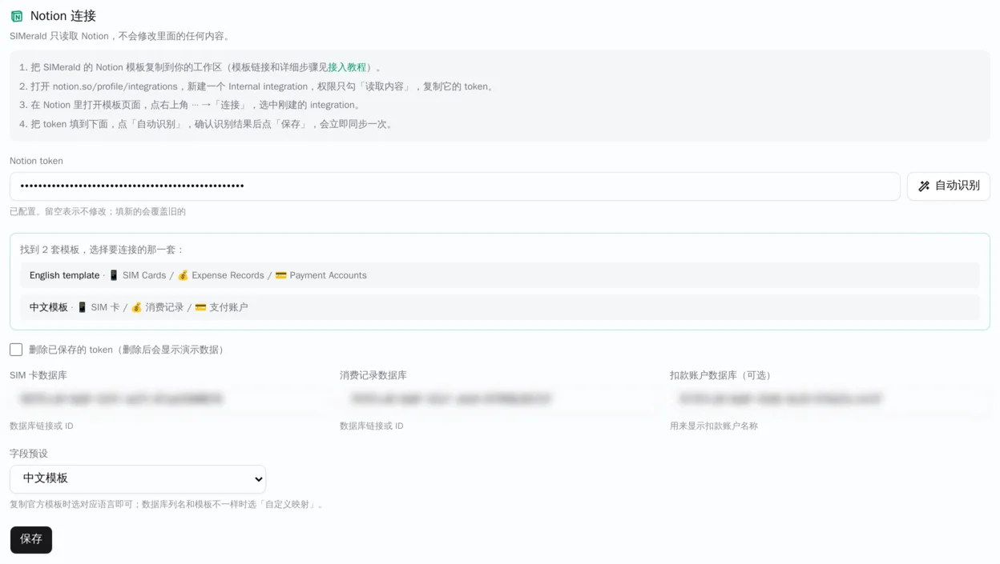
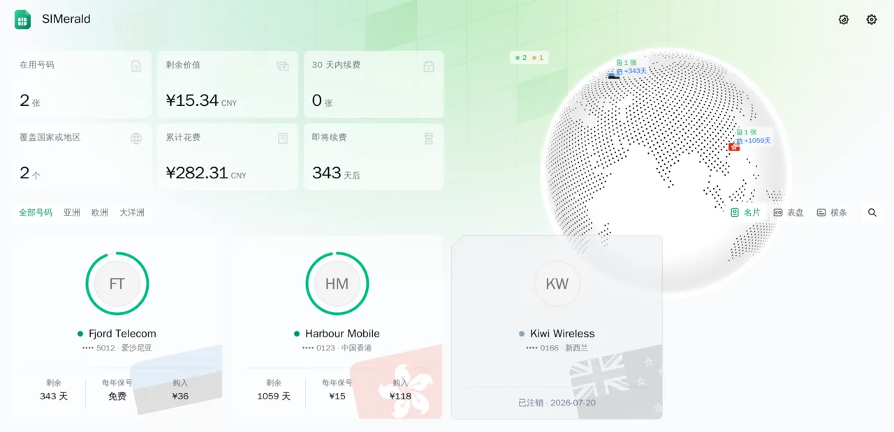

# 接入 Notion

[English](notion-setup.md) | 简体中文

SIMerald 使用 Notion 作为数据源。官方提供的 Notion 模板包含一个总控台页面（顶部为使用说明、按下次续费日期排序的「📊 续费一览」表格，以及「💰 消费分析」图表）和一个名为「源数据库（请勿删除）」的子页面，内含三个数据库：

- **📱 SIM 卡**：每行代表一张卡
- **💰 消费记录**：每行代表一笔购卡、续费、充值或其他费用，关联到对应卡片
- **💳 支付账户**（可选）：仅用于在站长登录后显示账户名称

带 🧪 图标的行是虚构示例（3 张卡：`Harbour Mobile · 0123`、`Fjord Telecom · 5012`、已注销的 `Kiwi Wireless · 0166`；5 条消费记录；2 个支付账户）。即使不配合 SIMerald，这套模板也可以单独作为续费管理工具使用。完整字段列表与公式源码见 [docs/notion-template/template.zh-CN.md](notion-template/template.zh-CN.md)。

## 你需要准备什么

- 一个 Notion 账号
- 一个已部署并运行的 SIMerald 实例（首次部署说明见 [README](../README.zh-CN.md)）

## 1. 复制模板

- 打开官方公开模板链接：
  - 中文模板：[SIMerald · SIM / eSIM 总控台（模板 v1）](https://blossom-elk-1de.notion.site/SIMerald-SIM-eSIM-v1-9aa81cd90a0f83eb92dd01597a2b9cde)
  - English template：[SIMerald · SIM / eSIM Console (Template v1)](https://blossom-elk-1de.notion.site/SIMerald-SIM-eSIM-Console-Template-v1-79581cd90a0f83d29c5a81659658c201)
- 点击页面右上角的「复制」（Duplicate），选择要复制到的 Notion 工作区。

## 2. 创建 Notion 集成（Integration）

- 打开 [https://www.notion.so/profile/integrations](https://www.notion.so/profile/integrations)，点击「新建集成」（New integration）。
- 填写名称（如 `SIMerald`），选择刚才复制模板所在的工作区，类型选择「内部」（Internal），点击保存。
- 在集成配置页面的「能力」（Capabilities）下，**只保留勾选「读取内容」（Read content）**（取消勾选更新内容和插入内容）；「用户信息」选择「不包含用户信息」，点击保存。
- 复制「内部集成密钥」（Internal Integration Secret，以 `ntn_` 开头）。这就是你的 Notion token，请妥善保管、切勿泄露。

## 3. 授权集成访问模板页面

- 打开你工作区中**复制出来的模板页面**（总控台页面）。
- 点击页面右上角的「•••」→「连接」（Connections），搜索你创建的集成名称，选中并确认。
- 授权会自动应用到该页面及其所有子页面，因此底下的三个源数据库也会一并获得访问权限。

## 4. 在 SIMerald 后台连接并自动识别

- 打开 `https://<你的域名>/admin` 并登录。
- 在「Notion 连接」面板中粘贴刚才复制的 token，点击「自动识别」。
- SIMerald 会列出该集成可读取的数据库，自动找到模板（同时识别是中文模板还是英文模板，并自动选中对应的「字段预设」），自动填入三个数据库 ID。如果找到了多套模板，会弹出列表供你选择。
- 点击「保存」：系统会保存配置并立即开始同步。



## 5. 检查同步结果并替换为自己的数据

- 查看后台「数据同步」面板：应显示「同步正常」，以及 3 张卡、5 条记录；打开网站首页可以看到 3 张带 🧪 的示例卡。
- 回到 Notion，删除卡片、消费记录和支付账户中所有带 🧪 的示例行，填入你自己的卡片数据。
- 回到 SIMerald 后台点击「立即同步」（或等待每日自动同步，默认时间为 `05:00` Asia/Shanghai，可配置）。



## 常见问题

### 点击「自动识别」提示「没找到 SIMerald 模板」？

- 刚在 Notion 中连接集成后，Notion 的搜索索引可能需要 1～2 分钟才会包含新共享的页面，请稍等片刻再重试。
- 请确认你连接集成的是**复制到自己工作区后的模板页面**，而不是官方公开模板链接。
- 请确认集成所属的工作区与模板所在的工作区一致。

### 同步报错信息分别代表什么？

- `Notion token 无效或已被撤销`：token 填写有误，或对应的集成已被删除。
- `Notion integration 没有读取权限`：请在集成的「能力」设置中勾选「读取内容」（Read content）。
- `找不到数据库：ID 不对，或者没有把页面共享给这个 integration`：数据库 ID 填写错误，或尚未在模板页面右上角「••• → 连接」中授权该集成。
- `Notion 请求太频繁`：触发了 Notion 速率限制，请稍后再试。

同步失败不会清空网站内容，SIMerald 会保留上一次成功同步的数据。

### 字段不匹配怎么办？

每次同步后，「数据同步」面板会列出缺失或类型不符的映射字段（`●` 表示会影响公开卡片墙的字段，`○` 表示只影响站长可见信息的字段）。你可以通过以下方式修复：

- 在 Notion 中恢复原有的列名；
- 在后台选择正确的「字段预设」（中文模板 / English template）；
- 使用「自定义映射（JSON）」。

### 如何修改列名或使用自己已有的数据库？

在后台将「字段预设」设为「自定义映射（JSON）」，输入覆盖中文模板默认列名的 JSON，例如：

```json
{ "cards": { "name": "Name", "number": "Phone" }, "records": { "card": "Card" } }
```

你也可以覆盖选项值列表，如 `statusValues`（使用中 / 已过期 / 已注销 对应的文本）和 `recordTypes`（首次购买 / 续费 / 额外充值 对应的文本）。完整键名列表见 [docs/configuration.md](configuration.md)。注意：模板中的公式也会按名称引用列，若在 Notion 中重命名了列，需要同步修改公式中的列名。

### 「⚠️ 数据检查」列是什么？

这是模板内置的公式列，用于提示缺失或不一致的数据（如号码格式错误、外币消费未填汇率、续费记录没填「本次有效期延至」等）。为空表示没有问题。该提示只在 Notion 里和 SIMerald 站长登录后显示，不会阻止数据同步。

### Notion 里的消费图表不显示怎么办？

Notion 免费版对单个工作区可展示的图表数量有限制。无法显示的图表可以直接删除，SIMerald 不会使用这些图表。

### 为什么示例卡之后会显示为已过期？

示例卡的有效期是固定的（例如 `Fjord Telecom` 有效期至 `2027-10-15`）。确认同步正常后，删除所有带 🧪 的示例行即可。

### 多币种消费金额是如何换算的？

金额统一以人民币（CNY）记账：每条消费记录通过「当时汇率」（即 1 单位支付币种兑换多少 CNY；若本身为 CNY 则留空）折算为人民币。累计消费等统计均基于折算后的 CNY 金额；网站前端则可根据实时汇率切换展示其他币种。

### 还能用环境变量配置 Notion 吗？

环境变量 `NOTION_TOKEN`、`NOTION_CARDS_DB`、`NOTION_RECORDS_DB`、`NOTION_ACCOUNTS_DB` 仍然可以作为默认值使用；「字段预设」则在后台面板中选择（默认为中文模板）。

### 可以不复制模板、手动自建数据库吗？

可以。请参考 [docs/notion-template/template.zh-CN.md](notion-template/template.zh-CN.md) 中的列名、选项和公式源码进行创建。

### 模板后续更新版本怎么办？

模板版本号（如 `v1`）显示在模板标题中。如果未来版本调整了字段，本教程会列出需要修改的内容；你也可以继续使用旧版模板副本。
